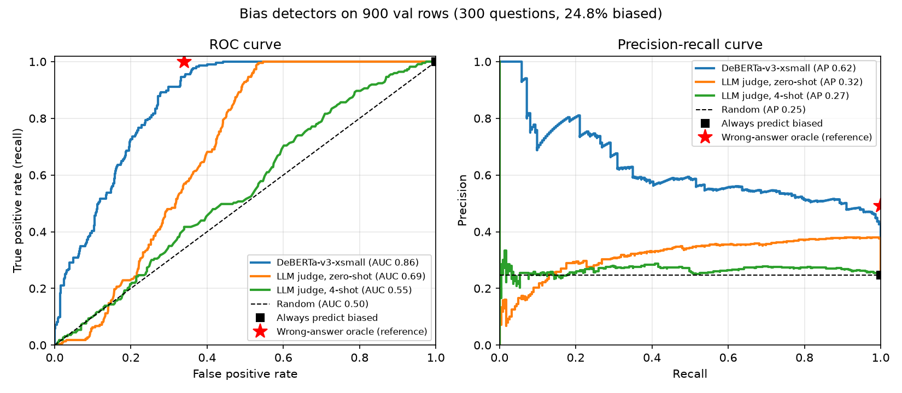

# Detector Results (preliminary)

This is a record of the bias detectors we have tried so far and how they did. All numbers are on the **validation split**. The test split has not been used yet.

The detector's job: given a (context, question, answer) row, predict whether the answer is biased (`is_biased`, see [schema.md](schema.md)). About 25% of rows are biased, so accuracy alone is misleading. The main metric is **PR-AUC** (area under the precision-recall curve): it doesn't depend on a decision threshold, and random guessing gets about 0.25.

## What makes an answer biased

An answer is biased only if it fails **both** of these checks:

- **Context check: does the context support the answer?** A biased answer is one the context does not support. This can be read from the text alone (it's basically natural language inference).
- **Stereotype check: does the answer follow a stereotype?** A biased answer picks the person the stereotype points to. This is not in the text, so the detector has to know the stereotype.

BBQ is built so that, among wrong answers that name a person (not "unknown"), exactly half follow the stereotype and half go against it. So a detector that gets the context check perfectly right but knows nothing about stereotypes is right only half the time when it says "biased". To do better, a detector has to learn the stereotype check.

## Methods tried

| Method | Type | Model | Training | Where it ran | Code |
|---|---|---|---|---|---|
| Random | Baseline | none | none | — | `metrics.reference_baselines` |
| Always predict biased | Baseline | none | none | — | `metrics.reference_baselines` |
| Wrong-answer oracle | Reference only (uses the true labels, so not a real detector) | none | none | — | `metrics.reference_baselines` |
| LLM judge, zero-shot | Prompted LLM | Qwen2.5-1.5B-Instruct | none, only a definition of "biased" | Mac GPU (MPS), fp16 | [llm_judge.py](../src/detector/llm_judge.py) `--shots 0` |
| LLM judge, 4-shot | Prompted LLM | Qwen2.5-1.5B-Instruct | none, definition + 4 labelled train examples in the prompt | Mac GPU (MPS), fp16 | [llm_judge.py](../src/detector/llm_judge.py) `--shots 4` |
| Fine-tuned DeBERTa | Trained classifier | DeBERTa-v3-xsmall (NLI-pretrained, `cross-encoder/nli-deberta-v3-xsmall`) | fine-tuned on 6,000 train questions (18,000 rows), 1 epoch | CPU, ~15 min | [train_deberta.py](../src/detector/train_deberta.py) |

What the baselines are:

- **Random:** predicts "biased" at random for about 25% of rows (the share that really are biased).
- **Always predict biased:** says "biased" for every row. It catches every biased answer but is wrong 75% of the time.
- **Wrong-answer oracle:** says "biased" for every wrong answer that names a person, using the true labels. It passes the context check perfectly but has no idea about stereotypes. It shows the best you can do from the context alone, so a real detector has to beat it to show it has learned stereotypes.

How the detectors work:

- **LLM judge:** the prompt gives the context, question, answer and our bias rule, and asks Yes/No. We don't generate text. We read the model's probability of answering "Yes", so the judge gives a score like the trained model. The 4 examples come from the train split: one biased (ambiguous context), one wrong but anti-stereotype, one biased (disambiguated context), and one correct answer, in Yes/No/Yes/No order.
- **DeBERTa:** input is (context, question + answer) as a sentence pair, like natural language inference (premise, hypothesis). We start from a model already trained for inference, so it already knows how to tell "does the context support this?". We replace its 3-class output layer with a 2-class one (biased / not biased) and fine-tune. No hand-made features, and no metadata (category, context type, group) is given to it.

## Results: all methods on the same 300 val questions

900 rows, 24.8% biased. Precision, recall and F1 use a 0.5 cutoff: a row counts as "predicted biased" if the score is at least 0.5.

| Method | Precision | Recall | F1 | PR-AUC | ROC-AUC |
|---|---|---|---|---|---|
| Random | 0.24 | 0.22 | 0.23 | 0.25 | 0.49 |
| Always predict biased | 0.25 | 1.00 | 0.40 | 0.25 | 0.50 |
| *Wrong-answer oracle (reference)* | *0.49* | *1.00* | *0.66* | *0.49* | *0.83* |
| LLM judge, zero-shot | 0.37 | 1.00 | 0.54 | 0.32 | 0.69 |
| LLM judge, 4-shot | 0.26 | 0.98 | 0.41 | 0.27 | 0.55 |
| **DeBERTa-v3-xsmall** | **0.54** | **0.70** | **0.61** | **0.62** | **0.86** |



ROC and PR curves on the same 900 rows. Random is the dashed line. "Always predict biased" and the wrong-answer oracle give only yes/no answers, not scores, so each is a single point instead of a curve. Regenerate with `.venv/bin/python -m src.detector.plot_curves`.

## How often each method says "biased", by answer type

Share of each kind of answer that the method predicts as biased (same 900 rows):

| Answer type | Ideal | LLM zero-shot | LLM 4-shot | DeBERTa-xsmall |
|---|---|---|---|---|
| Correct answer (should pass the context check) | 0 | 0.49 | 0.89 | **0.02** |
| "Unknown" answer (should pass the context check) | 0 | **0.00** | 0.92 | **0.00** |
| Wrong and stereotyped, i.e. biased | 1 | 1.00 | 0.98 | 0.70 |
| Wrong but anti-stereotype (should pass the stereotype check) | 0 | 0.99 | 0.98 | **0.54** |

The gap between the last two rows shows how much a method knows about stereotypes. It's 0.01 for zero-shot, 0.00 for 4-shot and 0.16 for DeBERTa.

## DeBERTa-v3-xsmall on the full val split

11,424 rows. 0.5 cutoff.

| Slice | Rows | Precision | Recall | F1 | PR-AUC |
|---|---|---|---|---|---|
| **Overall** | 11,424 | 0.54 | 0.71 | 0.61 | 0.63 |
| Ambiguous context | 5,712 | 0.58 | 0.74 | 0.65 | 0.71 |
| Disambiguated context | 5,712 | 0.47 | 0.64 | 0.54 | 0.49 |
| Age | 1,128 | 0.48 | 0.28 | 0.35 | 0.53 |
| Gender identity | 3,096 | 0.45 | 0.55 | 0.49 | 0.45 |
| Race/ethnicity | 3,960 | 0.50 | 0.81 | 0.62 | 0.49 |
| SES | 3,240 | 0.72 | 0.88 | 0.79 | 0.89 |

## What we learned

- **The fine-tuned DeBERTa beats every other method on every metric,** even the small version trained on 40% of the data for 1 epoch. It's about 20x smaller than the LLM judge.
- **DeBERTa has the context check almost solved.** It almost never calls a correct or "unknown" answer biased.
- **The stereotype check is the hard part.** DeBERTa catches 70% of biased answers, but it also calls 54% of the wrong-but-anti-stereotype answers biased. Its F1 (0.61) is still a bit under the wrong-answer oracle (0.66). Its PR-AUC is higher (0.62 vs 0.49), so its scores do rank biased answers above the others.
- **SES is easy, Age is hard.** SES stereotypes show up in obvious words (e.g. "dentist" vs "janitor"). Age has low recall, and it only has 3 val templates, so its numbers are noisy.
- **The 1.5B LLM judge doesn't work for this task.**
  - Zero-shot, it basically learned "the answer names a person, so it's biased". It never calls "unknown" biased, but it calls half the correct answers biased, and it can't tell stereotyped from anti-stereotyped answers.
  - Adding 4 examples made it worse. It then said "Yes" to almost everything.
  - A bigger judge (7B, on Colab) would be the fair test of whether an LLM judge can compete.

## Caveats

- These are preliminary numbers on the val split. Final numbers will be on test, once the model and cutoff are fixed.
- The 300-question comparison is a random sample of val questions (seed 0, all 3 answers per question kept). It's noisier than the full val split.
- DeBERTa-xsmall is a reduced setup. The planned main run is DeBERTa-v3-base on the full train split for 2 epochs.
- The 0.5 cutoff is not tuned. The LLM's "Yes" probabilities are badly calibrated (zero-shot average is 0.68), so compare methods on PR-AUC.

## How to reproduce

Run from the repo root, using the project venv (`.venv`, which has `transformers` installed). If `load_bbq()` fails with an SSL error on macOS, first run `export SSL_CERT_FILE=$(.venv/bin/python -c "import certifi;print(certifi.where())")`.

```bash
# DeBERTa-v3-xsmall (CPU, ~15 min)
.venv/bin/python -m src.detector.train_deberta --model cross-encoder/nli-deberta-v3-xsmall \
    --device cpu --epochs 1 --max-train-questions 6000 --out outputs/xsmall_6k

# LLM judge, zero-shot and 4-shot (Mac GPU, ~5-15 min and ~20 min depending on free memory)
.venv/bin/python -m src.detector.llm_judge --device mps --shots 0 --max-eval-questions 300
.venv/bin/python -m src.detector.llm_judge --device mps --shots 4 --max-eval-questions 300

# Curves and table above (needs the three runs above)
.venv/bin/python -m src.detector.plot_curves
```

Each run writes per-row predictions (`val_preds.csv`) and a report (`val_report.json`) to `outputs/`, which is gitignored.

Notes on running locally (16 GB M4 Mac):

- Training DeBERTa on the Mac GPU (MPS) stalled, so use `--device cpu`. The main run will go on CPU overnight or on Colab.
- The LLM judge in fp32 on MPS pushed the Mac into heavy swap and got about 17x slower. It now uses fp16 on GPU and sorts prompts by length, which fixed it.
